# 🔐 Secure VPC for a Production 3-Tier Architecture with Terraform

> A production-ready, highly available AWS VPC built with Terraform and deployed through a GitHub Actions pipeline using
> keyless OIDC authentication and Checkov security scanning.


---

## 1. Overview

### 1.1 Why the network layer matters

Amazon VPC is the networking foundation of an AWS environment. IAM controls *who* can access resources; the VPC controls
*how* resources communicate with each other and with the outside world. A well-architected VPC provides:

- **Security** through network isolation
- **High availability** through multi-AZ deployment
- **Scalability** to absorb future growth
- **Hybrid connectivity** readiness (VPN / Direct Connect), enabled by a non-overlapping CIDR plan

### 1.2 Problem statement

A company is launching a production web application that handles sensitive data (transactions, personal information).
The team currently deploys into a flat, single-subnet environment with one shared security group and no audit trail.
Moving from proof of concept to production exposes the following risks:

| # | Risk                          | Consequence                                            |
|---|-------------------------------|--------------------------------------------------------|
| 1 | No network segmentation       | A compromised instance can reach the database directly |
| 2 | No web/backend isolation      | Lateral movement is unrestricted                       |
| 3 | Uncontrolled outbound traffic | Internal servers have free internet access             |
| 4 | No documented boundaries      | PCI-DSS and SOC 2 audits cannot be passed              |
| 5 | Manual console provisioning   | No repeatability, version control, or drift detection  |



### 1.3 Objective and design goals

Automate the creation of a **secure, highly available VPC** across three Availability Zones using Infrastructure as
Code. Each risk above maps to a design response:

| Challenge                               | Solution                                                                                                                |
|-----------------------------------------|-------------------------------------------------------------------------------------------------------------------------|
| **Network segmentation** (blast radius) | Strict subnet isolation per tier; security groups allow only specific ports between adjacent tiers                      |
| **Egress control**                      | NAT Gateways for controlled, auditable outbound traffic; VPC Endpoints keep S3/DynamoDB traffic off the public internet |
| **Compliance and auditability**         | Per-tier security groups, NACLs, and VPC Flow Logs provide a documented, evidenced control set                          |
| **Drift and repeatability**             | Modular, state-tracked Terraform with one `.tfvars` file per environment (dev / staging / prod)                         |
| **Shift-left security**                 | Checkov runs in GitHub Actions at pull-request time, before anything reaches AWS                                        |

| Goal                    | Description                                  |
|-------------------------|----------------------------------------------|
| 🔒 **Secure**           | Defense-in-depth network security            |
| 📈 **Scalable**         | Built for growth and high availability       |
| 💰 **Cost-optimized**   | Reduced egress costs, right-sized resources  |
| 🏢 **Enterprise-ready** | Governance, compliance, and best practices   |
| ⚙️ **Automated**        | Terraform, CI/CD, and Infrastructure as Code |

### 1.4 What you will learn

- Production-grade VPC patterns, CIDR planning, and subnet design (public, private, isolated)
- NAT Gateway design, route tables, and egress optimization
- Security Groups and PCI-aligned NACL patterns
- VPC Endpoints and Zero Trust networking principles
- Modular Terraform with remote state
- GitHub Actions CI/CD with OIDC and Checkov
- Monitoring with VPC Flow Logs and CloudWatch

---

## 2. Architecture

### 2.1 Components

| Component            | Role                                                                        |
|----------------------|-----------------------------------------------------------------------------|
| **VPC**              | Isolated network (`10.0.0.0/16`) with DNS support and DNS hostnames enabled |
| **Subnets**          | Public, application, and data tiers across 3 AZs                            |
| **Internet Gateway** | Internet access for public subnets                                          |
| **NAT Gateways**     | Outbound-only internet access for private subnets (one per AZ)              |
| **Route Tables**     | One public table; one private table per AZ                                  |
| **Security Groups**  | Stateful, instance-level firewalls                                          |
| **Network ACLs**     | Stateless, subnet-level firewalls (additional layer)                        |
| **VPC Endpoints**    | Private access to AWS services (S3, DynamoDB)                               |
| **Flow Logs**        | Network traffic metadata sent to CloudWatch Logs                            |

### 2.2 Network layout

**Region:** `us-east-1` · **VPC CIDR:** `10.0.0.0/16`

| Tier                      | Purpose                         | AZ-a           | AZ-b           | AZ-c           |
|---------------------------|---------------------------------|----------------|----------------|----------------|
| **Public (Web)**          | ALB, NAT Gateways, bastion host | `10.0.1.0/24`  | `10.0.2.0/24`  | `10.0.3.0/24`  |
| **Private (Application)** | Application servers             | `10.0.11.0/24` | `10.0.12.0/24` | `10.0.13.0/24` |
| **Private (Data)**        | Databases and caches            | `10.0.21.0/24` | `10.0.22.0/24` | `10.0.23.0/24` |

> **CIDR planning:** `10.0.0.0/16` was chosen to avoid conflicts with future on-premises VPN connections. Octet ranges
> (`1x`, `11–13`, `21–23`) leave room for additional subnets per tier.

### 2.3 Routing

| Route table                 | Associated subnets              | Default route                            |
|-----------------------------|---------------------------------|------------------------------------------|
| **Public** (1)              | All public subnets              | `0.0.0.0/0` → Internet Gateway           |
| **Private** (3, one per AZ) | App and data subnets of that AZ | `0.0.0.0/0` → NAT Gateway of the same AZ |

Keeping each private route table pointed at its own AZ's NAT Gateway avoids cross-AZ traffic charges and prevents one AZ
failure from affecting the others.

### 2.4 Traffic flow


| # | Flow             | Path                                                                                       |
|---|------------------|--------------------------------------------------------------------------------------------|
| 1 | **Inbound**      | Users → Internet Gateway → Application Load Balancer (public subnets, all 3 AZs)           |
| 2 | **Application**  | ALB → application servers in private app subnets (business logic)                          |
| 3 | **Data**         | Application servers → databases/caches in private data subnets (no internet path)          |
| 4 | **Outbound**     | Private tiers → NAT Gateway (public subnet) → Internet Gateway (updates, third-party APIs) |
| 5 | **AWS services** | Private tiers → VPC Endpoints → S3 / DynamoDB (stays on the AWS network)                   |
| 6 | **CI/CD**        | Git push → GitHub Actions → OIDC → Terraform → AWS                                         |

---

## 3. Security Design

Security follows a **defense-in-depth** model with four layers:

| Layer | Control                    | Scope                                     |
|-------|----------------------------|-------------------------------------------|
| 1     | **Subnet isolation**       | Tier separation (public / app / data)     |
| 2     | **Network ACLs**           | Stateless, subnet level                   |
| 3     | **Security Groups**        | Stateful, instance level, least privilege |
| 4     | **Flow Logs + CloudWatch** | Visibility and audit evidence             |

> **Security model in one sentence:** Internet traffic enters only through the web tier → app servers are reachable only
> from the web tier → databases are reachable only from app servers → SSH into private tiers goes through a bastion
> restricted to a specific IP range.

### 3.1 Security Groups

Rules reference other security groups rather than CIDR ranges, so access follows the tier relationship instead of IP
addresses.

```
Internet ── :80/:443 ──► web-tier-sg ──► app-tier-sg ──► db-tier-sg
                                              ▲               ▲
                         bastion_cidr ─► bastion-sg ── :22 ───┘
```

| Security Group | Terraform resource           | Inbound                                                    | Outbound                                             |
|----------------|------------------------------|------------------------------------------------------------|------------------------------------------------------|
| **Web tier**   | `aws_security_group.web`     | 80, 443 from `0.0.0.0/0` (only SG exposed to the internet) | App port to app-tier SG                              |
| **App tier**   | `aws_security_group.app`     | App port from web-tier SG only; 22 from bastion SG         | 443 to the internet (via NAT), DB port to DB-tier SG |
| **DB tier**    | `aws_security_group.db`      | DB port from app-tier SG only; 22 from bastion SG          | None                                                 |
| **Bastion**    | `aws_security_group.bastion` | 22 from a restricted CIDR (office IP or `/32`)             | 22 to private tiers                                  |

> ⚠️ **Review before production:** Replace all open rules (`0.0.0.0/0`), including those on the default security group,
> with scoped rules, and tune the ports to your application.

### 3.2 Network ACLs

NACLs are stateless, so return traffic (ephemeral ports `1024–65535`) must be allowed explicitly.

| Subnet tier     | Rules                                                                                                                      |
|-----------------|----------------------------------------------------------------------------------------------------------------------------|
| **Public**      | Allow 80 and 443 inbound; allow SSH only from the restricted CIDR; allow ephemeral ports; block SSH from untrusted sources |
| **Application** | Deny inbound from the internet; allow traffic from the VPC CIDR                                                            |
| **Data**        | Deny all except traffic from the application subnet CIDRs                                                                  |

### 3.3 VPC Endpoints

- **Gateway endpoints** for S3 and DynamoDB are free and keep traffic inside the AWS network, which reduces both NAT
  data-processing cost and internet exposure.
- The architecture diagram also shows an **interface endpoint** (PrivateLink) for other AWS services.

### 3.4 Logging and monitoring

| Capability                            | Configuration                                                                                                  |
|---------------------------------------|----------------------------------------------------------------------------------------------------------------|
| **VPC Flow Logs**                     | Capture all traffic metadata; stored in CloudWatch Logs with **30-day retention** (adjust to compliance needs) |
| **CloudWatch Logs**                   | Centralized logging                                                                                            |
| **CloudWatch Metrics and Dashboards** | Operational metrics and real-time visibility                                                                   |
| **CloudTrail**                        | API-level audit trail                                                                                          |

### 3.5 Pipeline and state security

- **Remote state** is stored in a versioned, KMS-encrypted, non-public S3 bucket with DynamoDB locking
  (see [bootstrap module](#71-bootstrap)).
- **No long-lived credentials**: GitHub Actions authenticates to AWS with short-lived OIDC tokens
  (see [iam module](#72-iam-github-actions-oidc)).
- **Checkov** scans Terraform on every pull request.

---

## 4. High Availability

| Layer             | Strategy                                                                            |
|-------------------|-------------------------------------------------------------------------------------|
| **Compute**       | Distributed across 3 AZs (`us-east-1a`, `1b`, `1c`)                                 |
| **Load balancer** | ALB with cross-zone load balancing                                                  |
| **NAT Gateways**  | One per AZ, eliminating a single point of failure                                   |
| **Routing**       | One private route table per AZ, pointing to the local NAT Gateway                   |
| **Database**      | Primary in AZ-a, replicas in AZ-b and AZ-c, automatic failover (typically 30–120 s) |

---

## 5. Prerequisites

- [ ] AWS account with permissions to create VPC and IAM resources
- [ ] AWS CLI installed and configured
- [ ] Terraform `>= 1.0` (the pipeline pins a specific version via `TF_VERSION`)
- [ ] Git and a GitHub account (fork of the repository)
- [ ] Working knowledge of AWS networking concepts
- [ ] Security group and NACL rules reviewed for your workload

---

## 6. Project Structure

```
secure-vpc-for-three-tier-web-app/
├── .github/workflows/
│   ├── terraform-checkov.yml        # Checkov security scanning
│   └── website-deployment.yml       # Terraform deployment workflow
├── modules/
│   ├── bootstrap/                   # Remote state backend (S3 + DynamoDB)
│   ├── iam/                         # GitHub Actions OIDC role (ga-oidc.tf)
│   ├── security-groups/             # Web, app, DB, and bastion security groups
│   └── vpc/                         # VPC, subnets, NAT, routes, NACL, endpoints, flow logs
├── Documentation/                   # Project documentation
├── Screenshot verification/         # Post-deployment screenshots
├── backend.tf                       # State backend configuration
├── data.tf                          # Data sources
├── locals.tf                        # Common tags
├── main.tf                          # Root module wiring
├── outputs.tf                       # Output values
├── providers.tf                     # Terraform and AWS provider configuration
├── variables.tf                     # Input variables and defaults
├── dev-terraform.tfvars             # Dev environment values
├── staging-terraform.tfvars         # Staging environment values
├── prod-terraform.tfvars            # Prod environment values
└── .gitignore
```

Each module follows the standard `main.tf` / `variables.tf` / `outputs.tf` layout.

---

## 7. Terraform Modules

### 7.1 `bootstrap`

Creates the **remote state backend**. Run it once, before enabling remote state.

**Problem solved:** Terraform stores state locally by default. In a team or CI/CD setting, state must be shared,
protected, and locked.

| Resource                                             | Purpose                                                          |
|------------------------------------------------------|------------------------------------------------------------------|
| `aws_s3_bucket.terraform_state`                      | Stores `.tfstate` files                                          |
| `aws_s3_bucket_versioning`                           | Keeps previous states for rollback                               |
| `aws_s3_bucket_server_side_encryption_configuration` | Encrypts state at rest with AWS KMS                              |
| `aws_s3_bucket_public_access_block`                  | Blocks all public access                                         |
| `aws_dynamodb_table.terraform_locks`                 | State locking; prevents concurrent applies from corrupting state |

```
terraform apply
      │
      ▼
Read state  ◄── S3 bucket (versioned, encrypted, private)
      │
      ▼
Acquire lock ──► DynamoDB table (LockID)
      │
      ▼
Make changes
      │
      ▼
Write new state ──► S3 bucket
      │
      ▼
Release lock ──► DynamoDB (LockID row deleted)
```

### 7.2 `iam` (GitHub Actions OIDC)

Defined in `ga-oidc.tf`. Lets GitHub Actions authenticate to AWS with **OpenID Connect**, a keyless, token-based method.
No AWS credentials are stored in GitHub.

```
GitHub Actions job starts
      │
      ▼
GitHub issues a signed OIDC JWT
      │
      ▼
Workflow calls sts:AssumeRoleWithWebIdentity with the token
      │
      ▼
AWS validates the token against the registered OIDC provider
      │
      ▼
AWS checks the repository / organization conditions
      │
      ▼
AWS returns short-lived credentials (max 1 hour)
      │
      ▼
Terraform runs with those credentials
```

### 7.3 `security-groups`

Defines the network security boundary for the web, application, and database tiers, plus a bastion host for
administrative access. Rules are detailed in [section 3.1](#31-security-groups).

### 7.4 `vpc`

Builds the three-tier network.

```
Internet
    │
    ▼
Internet Gateway
    │
    ▼
┌────────────────────────────────────────────────────┐
│ VPC 10.0.0.0/16                                    │
│                                                    │
│  Public subnets (Web)        AZ-a    AZ-b    AZ-c  │
│   NAT GW + Elastic IP         ✔       ✔       ✔    │
│                                                    │
│  Private subnets (App)       AZ-a    AZ-b    AZ-c  │
│   Route table → local NAT    NAT-a   NAT-b   NAT-c │
│                                                    │
│  Private subnets (Data)      AZ-a    AZ-b    AZ-c  │
│                                                    │
│  Public NACL │ VPC Endpoints (S3, DynamoDB) │ Flow Logs │
└────────────────────────────────────────────────────┘
```

| Block                            | Description                                                 |
|----------------------------------|-------------------------------------------------------------|
| **VPC and Internet Gateway**     | Foundation; the IGW connects public subnets to the internet |
| **Three subnet tiers**           | Public, application, and data subnets in each AZ            |
| **Elastic IPs and NAT Gateways** | One per AZ: private subnet → NAT GW → IGW → internet        |
| **Route tables**                 | One public (→ IGW); one private per AZ (→ that AZ's NAT GW) |
| **Network ACLs**                 | Stateless subnet rules (see [3.2](#32-network-acls))        |
| **VPC Endpoints**                | Free gateway endpoints for S3 and DynamoDB                  |
| **VPC Flow Logs**                | Traffic metadata in CloudWatch Logs                         |

---

## 8. CI/CD Pipeline

### 8.1 Workflows

| Workflow                 | Purpose                                                                        |
|--------------------------|--------------------------------------------------------------------------------|
| `terraform-checkov.yml`  | Scans Terraform for misconfigurations on pull requests and at repository level |
| `website-deployment.yml` | Plans and applies the Terraform deployment, authenticating through OIDC        |

### 8.2 Required GitHub secrets

Configure under **Settings → Secrets and variables → Actions** in your fork.

| Secret                 | Value                                                        |
|------------------------|--------------------------------------------------------------|
| `AWS_REGION`           | `us-east-1`                                                  |
| `AWS_ROLE_ARN`         | ARN of the `github-actions-role` created by the `iam` module |
| `TF_BACKEND_S3_BUCKET` | Name of the state bucket created by `bootstrap`              |
| `TF_VERSION`           | Terraform version to use (for example `1.14.8`)              |

---

## 9. Deployment

### Step 1: Fork and clone

```bash
git clone https://github.com/darvin-rakotomalala/secure-vpc-for-three-tier-web-app
cd secure-vpc-for-three-tier-web-app
```

### Step 2: Configure variables

Edit `dev-terraform.tfvars` (region, domain name, default tags). **Do not put secrets in this file.**

### Step 3: Bootstrap the state backend (once)

Apply the `bootstrap` module to create the S3 bucket and DynamoDB lock table, then reference them in `backend.tf`.

### Step 4: Deploy the infrastructure

```bash
terraform init
terraform plan  -var-file="dev-terraform.tfvars" -out=tfplan
terraform apply tfplan
```

Applying the saved plan guarantees that what was reviewed is exactly what is deployed. For staging or prod, substitute
the matching `.tfvars` file.

### Step 5: Enable the pipeline

Add the [GitHub secrets](#82-required-github-secrets). From then on, pull requests trigger Checkov and merges trigger
the deployment workflow.

---

## 10. Verification

After deployment, confirm each resource in the AWS Console.

| Resource              | What to check                                 | Screenshots                                                                                                                                                                                                                                                                                |
|-----------------------|-----------------------------------------------|--------------------------------------------------------------------------------------------------------------------------------------------------------------------------------------------------------------------------------------------------------------------------------------------|
| **Terraform outputs** | Values returned after apply                   |                                                                                                                                                                                      |
| **VPC**               | CIDR `10.0.0.0/16`, DNS enabled, resource map |                                                                                                                                                                                     |
| **Internet Gateway**  | Attached to the VPC                           |                                                                                                                                                                                                                                  |
| **Subnets**           | 9 subnets across 3 AZs                        |                                                                                                                                                                                                                                             |
| **Elastic IPs**       | One per NAT Gateway                           |                                                                                                                                                                                                                                           |
| **NAT Gateways**      | 3, one per AZ, in public subnets              |                                                                                                                                                                                                                                      |
| **Route tables**      | Public → IGW; private → local NAT             |        |
| **Network ACLs**      | Rules per tier                                |                                                                                                                                                                                          |
| **VPC Endpoints**     | S3 and DynamoDB gateway endpoints             |                                                                                                                                                                                                                                     |
| **Flow Logs**         | Active, delivering to CloudWatch              |                                                                                                                                                                            |
| **Security Groups**   | Web, app, DB, bastion rules                   |      |

---

## 11. Cost Optimization

| Feature           | Optimization                                                                                          |
|-------------------|-------------------------------------------------------------------------------------------------------|
| **NAT Gateways**  | One per AZ for production resilience; consider a single NAT Gateway or NAT instances for dev/non-prod |
| **VPC Endpoints** | Free gateway endpoints for S3 and DynamoDB cut NAT data-processing and transfer costs                 |
| **Flow Logs**     | 30-day retention balances monitoring needs against storage cost                                       |

---

## 12. Conclusion

This project delivers a **production-grade secure VPC** on AWS, provisioned entirely with Terraform:

- **Network:** VPC, three-tier subnets across 3 AZs, Internet Gateway, NAT Gateways, route tables
- **Security:** tiered security groups, network ACLs, VPC endpoints, Flow Logs
- **Automation:** remote state with locking, modular code, per-environment variables, and a GitHub Actions pipeline with
  OIDC keyless authentication and Checkov scanning

---

*Project by Darvin · Secure VPC for Production 3-Tier Architecture*
