# Secure VPC for a Production 3-Tier Web Application (Terraform)

Infrastructure as Code that builds a **secure, highly available, cost-optimized AWS VPC** for a three-tier web
application (web, application, database) across **3 Availability Zones**, deployed through a **GitHub Actions CI/CD
pipeline** with automated **Checkov** security scanning.

| Pillar                          | What it means here                                                                                   |
|---------------------------------|------------------------------------------------------------------------------------------------------|
| **Secure**                      | Defense-in-depth: network isolation per tier, Security Groups, Network ACLs, Flow Logs               |
| **Scalable & Highly Available** | 9 subnets across 3 AZs, one NAT Gateway per AZ, no single point of failure                           |
| **Cost-optimized**              | S3 and DynamoDB traffic stays on the AWS network via Gateway Endpoints, reducing NAT/egress costs    |
| **Enterprise-ready**            | Remote state, OIDC-based CI/CD, static security checks, consistent tagging, multi-environment tfvars |
| **Automated**                   | 100% Terraform, no console-driven configuration                                                      |

---

## Business Problem

Deploying an enterprise multi-tier application on a flat or manually built cloud network exposes an organization to
operational, financial and compliance risk. This project addresses five core challenges:

| Challenge                                                                                                     | Solution implemented                                        |
|---------------------------------------------------------------------------------------------------------------|-------------------------------------------------------------|
| **Security and defense-in-depth**: sensitive app and database tiers must never be reachable from the internet | Tiered subnets, chained Security Groups, subnet-level NACLs |
| **High availability**: single points of failure in routing or outbound access                                 | 3 AZs, dual-path routing, one NAT Gateway per AZ            |
| **Cost and route optimization**: traffic to AWS services crossing the public internet increases egress costs  | Gateway VPC Endpoints for S3 and DynamoDB                   |
| **Governance**: console-driven changes cause drift and misconfiguration                                       | Terraform, GitHub Actions, Checkov static analysis          |
| **Observability and auditing**: no visibility into network traffic paths                                      | VPC Flow Logs                                               |

---

## Architecture


### Components

| Component               | Purpose                                                                  |
|-------------------------|--------------------------------------------------------------------------|
| **VPC** (`10.0.0.0/16`) | Isolated network with DNS support and DNS hostnames enabled              |
| **Subnets** (9)         | Public, application and data tiers, 3 per tier, one per AZ               |
| **Internet Gateway**    | Internet access for public subnets                                       |
| **NAT Gateways** (3)    | Outbound-only internet access for private subnets, one per AZ            |
| **Route Tables**        | 1 public table and 3 private tables (one per AZ)                         |
| **Security Groups**     | Instance-level firewalls for web, app, db and bastion                    |
| **Network ACLs**        | Subnet-level stateless firewall, second layer of defense                 |
| **VPC Endpoints**       | Gateway endpoints for S3 and DynamoDB                                    |
| **Flow Logs**           | Network traffic logging for troubleshooting, threat detection and audits |

### Network addressing (`10.0.0.0/16`)

| Tier            | Type    | AZ-a (`us-east-1a`) | AZ-b (`us-east-1b`) | AZ-c (`us-east-1c`) | Hosts                                       |
|-----------------|---------|---------------------|---------------------|---------------------|---------------------------------------------|
| **Web**         | Public  | `10.0.1.0/24`       | `10.0.2.0/24`       | `10.0.3.0/24`       | Load balancers, bastion hosts, NAT Gateways |
| **Application** | Private | `10.0.11.0/24`      | `10.0.12.0/24`      | `10.0.13.0/24`      | Application servers                         |
| **Database**    | Private | `10.0.21.0/24`      | `10.0.22.0/24`      | `10.0.23.0/24`      | Databases and caches                        |

### Routing

| Route table                 | Default route (`0.0.0.0/0`) | Additional routes                                  |
|-----------------------------|-----------------------------|----------------------------------------------------|
| **Public** (1, shared)      | Internet Gateway            | none                                               |
| **Private** (3, one per AZ) | NAT Gateway in the same AZ  | S3 and DynamoDB prefix lists via Gateway Endpoints |

---

## Traffic Flow



1. **Inbound**: users reach the Internet Gateway, which forwards traffic to the Application Load Balancer in the public
   subnets across all three AZs.
2. **Application tier**: the ALB distributes requests to the application servers in the private app subnets
   (`10.0.11-13.0/24`).
3. **Data tier**: application servers query databases and caches in the private data subnets (`10.0.21-23.0/24`). These
   subnets have no internet route.
4. **Outbound** (dashed lines in the diagram): private app instances reach the internet (package downloads, third-party
   APIs) through the NAT Gateway in their own AZ, then out via the Internet Gateway.
5. **AWS services**: traffic to S3 and DynamoDB goes through the Gateway Endpoints and never leaves the AWS network.
6. **CI/CD**: a push to GitHub triggers GitHub Actions, which deploys to AWS.

---

## Security Design

Security is layered so that a failure in one control does not expose the tiers behind it.

| Layer                    | Scope               | Implementation                                                                           |
|--------------------------|---------------------|------------------------------------------------------------------------------------------|
| **Network isolation**    | Subnet              | Public, application and data tiers in separate subnets; data tier has no internet route  |
| **Security Groups**      | Instance (stateful) | `web`, `app`, `db` and `bastion` groups with ingress rules referencing the upstream tier |
| **Network ACLs**         | Subnet (stateless)  | Explicit inbound and outbound rules per tier                                             |
| **Private connectivity** | VPC                 | S3 and DynamoDB Gateway Endpoints                                                        |
| **Monitoring**           | VPC                 | VPC Flow Logs                                                                            |
| **Static analysis**      | Code                | Checkov scans on every repository change and pull request                                |
| **CI/CD authentication** | Pipeline            | GitHub Actions assumes an IAM role via OIDC, so no long-lived AWS keys are stored        |

---

## Project Structure

```
secure-vpc-for-three-tier-web-app/
├── .github/workflows/
│   ├── terraform-checkov.yml       # Checkov security scanning
│   └── website-deployment.yml      # Terraform deployment workflow
├── modules/
│   ├── bootstrap/                  # Remote backend for the Terraform state file
│   │   ├── main.tf
│   │   ├── outputs.tf
│   │   └── variables.tf
│   ├── iam/                        # IAM role and permissions
│   │   ├── ga-oidc.tf              # Terraform execution role for GitHub Actions (OIDC)
│   │   ├── outputs.tf
│   │   └── variables.tf
│   └── vpc/                        # Networking
│       ├── main.tf
│       ├── outputs.tf
│       └── variables.tf
├── Documentation/                  # Project documentation
├── AWS services study note/        # AWS services study notes
├── Screenshot verification/        # Screenshots taken after a successful deployment
├── backend.tf                      # Remote state backend configuration
├── data.tf                         # Data sources
├── locals.tf                       # Common tags
├── main.tf                         # Root module wiring
├── outputs.tf                      # Output values
├── providers.tf                    # Terraform and AWS provider configuration
├── variables.tf                    # Input variables and defaults
├── dev-terraform.tfvars            # Dev environment values
├── staging-terraform.tfvars        # Staging environment values
├── prod-terraform.tfvars           # Prod environment values
└── .gitignore
```

---

## Terraform Modules

| Module          | Responsibility                                                                           |
|-----------------|------------------------------------------------------------------------------------------|
| **`bootstrap`** | Creates the backend resources that store the Terraform state                             |
| **`iam`**       | Creates the IAM role (trusted via GitHub OIDC) that GitHub Actions uses to run Terraform |
| **`vpc`**       | Creates all networking resources (see below)                                             |

### `vpc` module resources

| Resource                          | Terraform address                                                              | Notes                                  |
|-----------------------------------|--------------------------------------------------------------------------------|----------------------------------------|
| VPC with DNS flags                | `aws_vpc.main`                                                                 | `10.0.0.0/16`                          |
| Internet Gateway                  | `aws_internet_gateway.main`                                                    | Attached to the VPC                    |
| 9 subnets                         | `aws_subnet.public` / `app` / `db`                                             | Created with `count` loops, 3 per tier |
| 3 Elastic IPs + NAT Gateways      | `aws_eip.nat`, `aws_nat_gateway.main`                                          | One per AZ                             |
| 1 public + 3 private route tables | `aws_route_table.public` / `private`                                           | Plus subnet associations               |
| 4 Security Groups + rules         | `aws_security_group.web` / `app` / `db` / `bastion`, `aws_security_group_rule` |                                        |
| Network ACLs + rules              | `aws_network_acl.public` (and per-tier ACLs)                                   | Inbound and outbound rules             |
| Gateway Endpoints                 | `aws_vpc_endpoint.s3` / `dynamodb`                                             |                                        |
| Flow Logs                         | `aws_flow_log`                                                                 | Traffic logging                        |

---

## Outputs

| Output             | Description                |
|--------------------|----------------------------|
| `vpc_id`           | ID of the VPC              |
| `vpc_cidr`         | CIDR block of the VPC      |
| `public_subnets`   | List of public subnet IDs  |
| `private_subnets`  | List of private subnet IDs |
| `nat_gateways`     | List of NAT Gateway IDs    |
| `internet_gateway` | Internet Gateway ID        |


---

## CI/CD Workflows

| Workflow       | File                                       | Purpose                                                                                                               |
|----------------|--------------------------------------------|-----------------------------------------------------------------------------------------------------------------------|
| **Checkov**    | `.github/workflows/terraform-checkov.yml`  | Scans Terraform for misconfigurations on repository changes and pull requests                                         |
| **Deployment** | `.github/workflows/website-deployment.yml` | Runs Terraform to provision the VPC, subnets, gateways, route tables, Security Groups, endpoints, NACLs and Flow Logs |

---

## Quick Start

### Prerequisites

- [Terraform](https://developer.hashicorp.com/terraform/install) installed
- An AWS account and credentials configured locally (for example `aws configure` or SSO)
- Git

### 1. Clone the repository

```bash
git clone https://github.com/darvin-rakotomalala/secure-vpc-for-three-tier-web-app
cd secure-vpc-for-three-tier-web-app
```

### 2. Configure variables

Edit `dev-terraform.tfvars` (or the staging / prod file) to set your region, domain name and default tags. **Do not put
secrets in tfvars files.**

### 3. Deploy

```bash
terraform init
terraform fmt -recursive
terraform validate
terraform plan  -var-file="dev-terraform.tfvars" -out=tfplan
terraform apply tfplan
```

> Applying the saved plan guarantees that exactly what you reviewed is deployed. For unattended runs you can instead use
> `terraform apply -var-file="dev-terraform.tfvars" -auto-approve`.

### 4. Migrate to the remote backend (optional)

1. Enable the backend configuration in `backend.tf`.
2. Migrate the state:

   ```bash
   terraform init -migrate-state
   ```

---

## Verification

Full documentation is in `Documentation/`. All screenshots are in `Screenshot verification/`.

| Resource             | Screenshot                                                              |
|----------------------|-------------------------------------------------------------------------|
| **VPC**              |                              |
| **Internet Gateway** |  |
| **Subnets**          |                      |
| **NAT Gateways**     |          |
| **Route Tables**     |          |
| **Network ACLs**     |                          |
| **VPC Endpoints**    |        |
| **Flow Logs**        |      |
| **Security Groups**  |   |

---

## Cleanup

Destroy all resources to avoid ongoing charges (NAT Gateways and Elastic IPs are billed hourly):

```bash
terraform destroy -var-file="dev-terraform.tfvars" -auto-approve
```

---

## License

This project is for learning and demonstration purposes. You may adapt or extend it for your own use.
